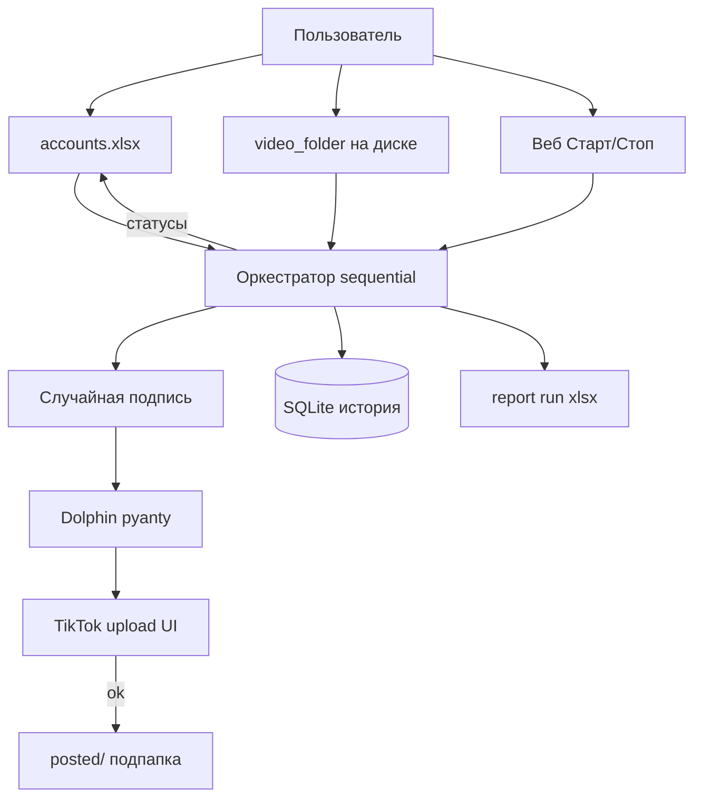

# План: автопубликация TikTok (v1–v4)

**v4 (онбординг + geo + прогрев):** см. [`ONBOARDING.ru.md`](ONBOARDING.ru.md), `session.order` в `settings.yaml`, лист «Онбординг» в Excel. При прогреве FYP рекомендуется `max_concurrent_profiles: 1`.

---

# План: автопубликация TikTok (финальная спецификация v1)

Документ объединяет все согласованные решения. Реализация — Python на Windows, Dolphin Anty, один Excel-реестр, локальный веб «Старт / Стоп».

---

## 1. Цель

Локальная программа на вашем ПК:

- читает **один Excel** со всеми аккаунтами;
- берёт видео из **указанных папок**;
- по **Старт** выкладывает **`videos_per_run` роликов на аккаунт** за один запуск;
- для каждого ролика выбирает **случайную подпись** из вариантов в строке Excel;
- после успеха **переносит файл** в подпапку **`posted/`**;
- пишет **отчёт Excel** и обновляет статусы в реестре (если файл не занят).

TikTok-логин хранится в **профиле Dolphin** (вход вручную один раз). Пароли в код не вшиваются.

---

## 2. Зафиксированные решения

| Тема | Решение |
|------|---------|
| Реестр | **Один** файл `.xlsx` на все аккаунты |
| Видео | Колонка **`video_folder`** — только оттуда, `.mp4` / `.mov` |
| Лимит за запуск | **`videos_per_run`** на строку (не лимит «в сутки» в v1) |
| Подписи | Колонка **`caption_variants`** в **той же строке**, разделитель **`|||`** |
| Выбор подписи | **Случайный** вариант на каждый ролик |
| Порядок аккаунтов | **Sequential:** сначала все N роликов с **1-й** строки (active), потом все N со **2-й**, … по таблице |
| После успеха | **Вариант A:** файл → **`video_folder/posted/`** |
| Публикация | **Dolphin Anty** + **Patchright** (CDP), upload через веб TikTok |
| Интерфейс | **Веб-дашборд** (Старт / Стоп / отчёт) + **CLI** |
| Тех. настройки | **`settings.yaml`**: путь к Excel, Dolphin, паузы, порт UI — **не** список аккаунтов |

---

## 3. Схема работы



---

## 4. Excel: лист «Аккаунты»

Путь: `excel.registry_path` в [`config/settings.yaml`](../config/settings.example.yaml) (пример: `./config/accounts.xlsx`).

| Колонка | Обяз. | Пример | Описание |
|---------|-------|--------|----------|
| account_no | да | 1 | Номер аккаунта |
| account_name | нет | Shop_1 | Для отчёта |
| video_folder | да | `D:\Videos\acc01` | Папка с роликами |
| dolphin_profile_id | да | 123456789 | ID профиля Dolphin |
| videos_per_run | да | 3 | Роликов **за один Старт** |
| caption_variants | да | см. ниже | Варианты подписей |
| active | да | да | да/нет — участвует в прогоне |
| last_run_status | авто | ok / error | Обновляет программа |
| last_run_error | авто | | Текст ошибки |
| last_run_at | авто | | Время последней активности по строке |

**caption_variants** (одна ячейка):

```text
Текст 1 #fyp|||Текст 2 #shop|||Текст 3
```

Пустой список после разбора → ошибка, ролик не публикуется.

Подробнее: [`EXCEL_SPEC.ru.md`](EXCEL_SPEC.ru.md).

---

## 5. Один запуск «Старт» (алгоритм)

1. Прочитать Excel (лист «Аккаунты»).
2. Отфильтровать `active = да`, порядок — **как в таблице сверху вниз**.
3. Для **каждой** строки по очереди:
   - `remaining = videos_per_run`
   - пока `remaining > 0`:
     - взять **следующий** файл из `video_folder` (не из `posted/`, сортировка по mtime из settings);
     - если файлов нет → зафиксировать ошибку/пропуск, выйти из цикла для этого аккаунта;
     - `caption = random(caption_variants)`;
     - старт Dolphin profile → upload → stop profile;
     - при **ok**: **переместить** файл в `video_folder/posted/`; `remaining -= 1`;
     - при **error**: записать в отчёт, `remaining -= 1` (попытка съедает слот) или не съедает — **по умолчанию: попытка съедает слот**, чтобы не зациклиться на одном битом файле;
     - пауза `delay_between_posts_sec` (random min–max из settings);
     - если пользователь нажал **Стоп** — после текущего ролика завершить прогон.
4. Сохранить **отчёт** `data/reports/report_<run_id>.xlsx` (колонки: account_no, account_name, file, caption_used, status, error, times).
5. Обновить Excel-строки (если файл не открыт в Excel).

**Пример:** строки 1–3, `videos_per_run` = 2, 1, 2 →  
acc1×2, acc2×1, acc3×2 → конец.

---

## 6. Папки и очередь

```text
D:\Videos\acc01\
  clip_a.mp4      ← кандидаты на публикацию
  clip_b.mp4
  posted\
    clip_old.mp4  ← уже выложено, не сканируется
```

- Сканируется **только корень** `video_folder`, без рекурсии.
- После успеха: `shutil.move` → `posted/` (создать `posted/`, если нет).

---

## 7. Dolphin и антидетект

- Desktop **Dolphin Anty** запущен, Local API (обычно порт **3001**).
- **pyanty** + **Patchright**: `connect_over_cdp`, контекст **`browser.contexts[0]`**, без `new_context()`.
- Селекторы TikTok: [`config/selectors.yaml`](../config/selectors.yaml).
- **Один открытый профиль Dolphin** в момент времени.

---

## 8. Интерфейс

**Веб** (`http://127.0.0.1:8765` по умолчанию):

- Таблица из Excel: аккаунт, папка, N за run, очередь (число mp4 в папке), last status.
- **Старт**, **Стоп**, **Скачать отчёт**.
- Блок «Сейчас»: account, файл, превью подписи.

**CLI:**

```bash
tiktok-publisher serve
tiktok-publisher start --foreground
tiktok-publisher stop
tiktok-publisher report --run last
tiktok-publisher doctor
```

---

## 9. Структура проекта (целевая)

```text
tiktok-publisher/
  pyproject.toml
  README.ru.md
  docs/
    PLAN.ru.md              ← этот файл
    EXCEL_SPEC.ru.md
  config/
    settings.yaml           ← пользователь (из example)
    accounts.xlsx           ← пользователь (из template)
    accounts.template.xlsx
    selectors.yaml
    settings.example.yaml
  data/
    state.db
    reports/
  src/tiktok_publisher/
    excel_registry.py
    queue.py
    captions.py             # split ||| + random
    orchestrator.py         # sequential + posted move
    dolphin_client.py
    publisher.py
    state.py
    report.py
    api.py
    static/index.html
    __main__.py
  tests/
```

---

## 10. Этапы реализации

| # | Этап | Результат |
|---|------|-----------|
| 1 | `accounts.template.xlsx`, excel_registry, captions | Чтение строк, random подпись |
| 2 | queue + posted/ + SQLite | Следующий файл, move после ok |
| 3 | orchestrator sequential + dry-run | Старт/Стоп без TikTok |
| 4 | dolphin_client + publisher | Реальная публикация |
| 5 | FastAPI + dashboard + report xlsx | UI |
| 6 | README.ru, doctor | Установка Windows |

**Вне v1:** autotok, лимит в сутки, round-robin, подписи из второго листа, параллельные профили, авто-капча.

---

## 11. Риски

- TikTok меняет UI → правка `selectors.yaml`.
- Excel открыт → запись в реестр может не пройти; отчёт на диск всё равно сохраняется.
- Dolphin Free → ограничения API/cookies.
- Массовый постинг → риски модерации; паузы и лимиты N на вашей стороне.

---

## 12. Статус репозитория

Сделано: `pyproject.toml`, `config/*.example.yaml`, `selectors.yaml`, `docs/EXCEL_SPEC.ru.md`, `docs/PLAN.ru.md`.

Дальше: реализация по таблице этапов §10.
